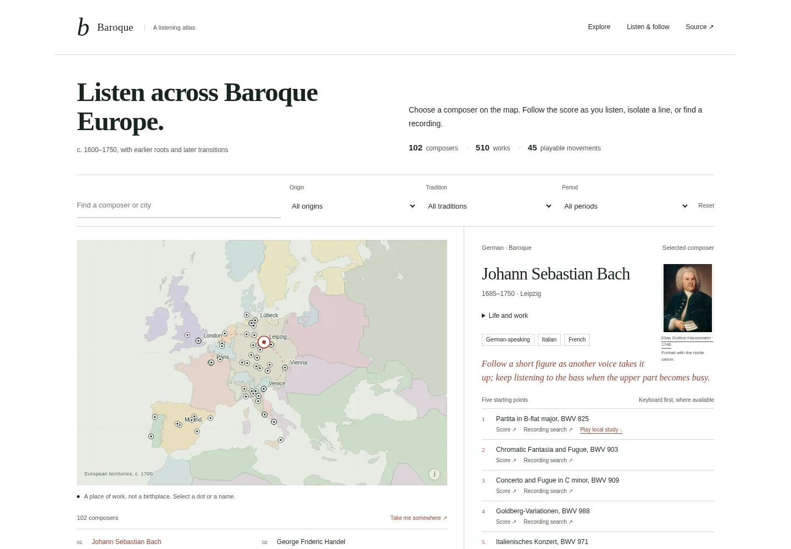

# Baroque · A listening atlas



[Mobile view](screenshots/mobile.webp)

A browser app for exploring European Baroque music and listening to its structure.
**102 composers, 510 source-linked works, 45 complete source-MIDI movements and a
three-voice, six-bar Bach study.** It runs locally without an account or backend.

## Try it

Requires Node.js 20 or newer. No npm packages need to be installed.

```sh
git clone https://github.com/sargonxg/Baroque-music-room.git
cd Baroque-music-room
npm test
npm run dev
```

Open **http://127.0.0.1:8000**. Choose a composer on the map or in the directory.
Filter by origin, musical tradition, period or name/city. The right panel offers
five starting points, source scores and recording searches.

At the listening desk, press **Listen**. Isolate the colored voices in the Bach
study, adjust speed, seek or switch to a full source movement. Every local selection shows colored staff notation that follows playback,
including during seeks and pauses. Click a note to seek to its onset. The
notation is derived from MIDI: spelling, clefs, rests and rhythm symbols are
inferred. A separate disclosure retains the source engraving or opening preview
where available. The six-bar Bach study has source-defined independent voices;
full movements retain source tracks, which may combine voices.
Download MIDI or open the source edition to go further. Choose harpsichord, clavichord, piano-study or organ synthesis; adjust the room,
tuning, speed and voice controls. Solo a line or set an A-B loop to study a
passage. Playback is a local keyboard approximation, not a recording. The exact-
title YouTube link searches for a recording without loading an embedded player.

The initial map, catalog and six-bar study are self-contained in `dist/index.html`.
They also work when that file is opened directly. Serve `dist/` over HTTP to load
other movements. A complete offline HTTP copy needs no remote connection for
local playback; external source and recording links naturally require internet.

## Build and deploy

```sh
npm run build
```

Upload **only `dist/`** to a static host. Relative asset paths work from a
subdirectory. The build emits a self-contained initial page and local supporting
music/source assets. There are no secrets, databases, background tasks, analytics,
model calls or streaming audio subscriptions.

For Cloudflare Workers with static assets, `wrangler.jsonc` is included. The
configuration deliberately disables `workers.dev` and version previews. Configure
an approved custom-domain route or owner-only Access deployment before deploying;
the repository does not turn on a public service automatically. An example local
CLI sequence, once you have configured the route and account securely:

```sh
npm run build
npx wrangler deploy
```

Cloudflare Access is configured separately at the account level. The static
security headers are not authentication. Nothing in this repo sets a billing
limit or guarantees a host's included allowance.

## Data and limits

- `data/composers.json`: biographical references, working-city coordinates,
  descriptive origin, periods, forms, affinities and listening notes.
- `data/works.json`: five bibliographic starting points per composer, with IMSLP
  evidence, edition links and explicit recording **search** links.
- `data/catalogue.json`: the 45 source movements playable locally.
- `data/rights.json`: per-edition provenance and rights, including CC BY-SA assets.
- `data/favorites.json`: 15 curated local listening selections; matching 30-second
  source-track previews are in `data/favorite-previews.json` for reuse.
- `data/provenance.json`: source descriptions and asset hashes.

The historical map is schematic, not a current border map. Dots identify one
working city and can overlap. The name directory exposes all composers at a
shared location. National/style labels are descriptive and nonexclusive; Bach's
sons and transitional figures are marked. Five works are starting points, not a
claim of the "top" five. Most catalog works link outward and are not locally
playable; local studies are clearly labeled.

## Development

`src/engine.mjs` contains catalog filtering/projection/validation. `src/audio.mjs`
implements scheduled WebAudio playback with bounded lookahead, muted-track gains,
seek/speed controls and cleanup. `src/app.mjs` is the accessible UI. The build
inlines the initial UI resources; supporting source editions remain separate.

`npm test` checks catalog/source completeness, music boundaries, geographic
projection, filters, safe links, source MIDI hashes and the three-voice study's
note/score correspondence. Browser layout screenshots are evidence of rendered
layout, not audible synthesis or human screen-reader verification.

See [the notation/audio contract](docs/NOTATION-AND-AUDIO.md) for the reusable
renderer and transport, and [the 100-point refinement record](docs/REFINEMENTS-100.md)
for implementation evidence and remaining limits.

Original code is MIT. The historical map is GPL-3.0; music editions retain their
individual PD or CC BY-SA terms. Read [ATTRIBUTION.md](ATTRIBUTION.md) before reuse.
