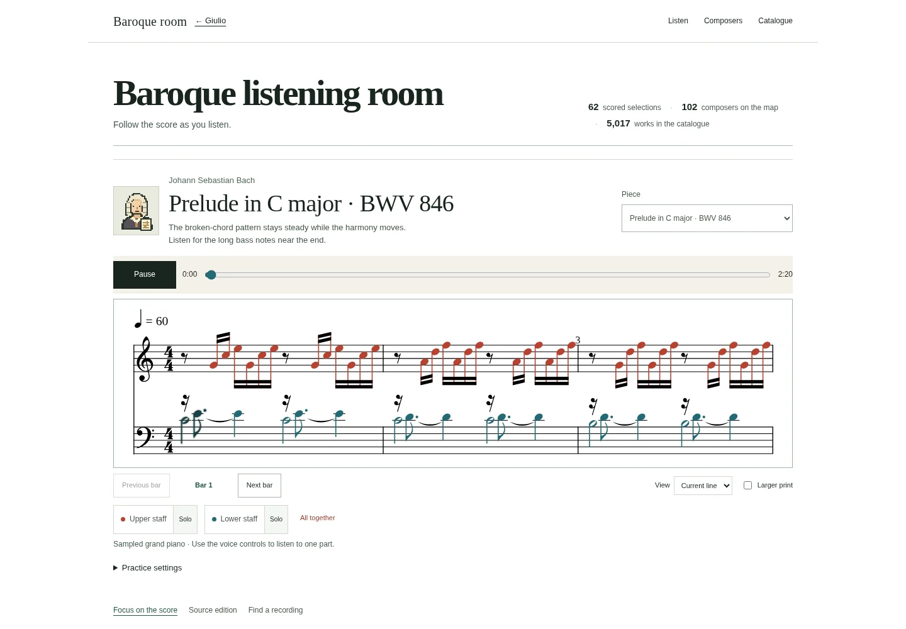

# Baroque · A listening atlas

Listen to 62 complete keyboard pieces or named movements with a synchronized
MusicXML score. The collection includes Bach’s Inventions, Sinfonias and
Well-Tempered Clavier preludes, alongside Handel, Scarlatti, Rameau and other
composers. Explore 102 composers on the map and search 5,017 Open Opus
catalogue entries for editions and recordings. The 45 earlier MIDI movements
and the six-bar Bach study remain in the piece selector.

## Run locally

Node.js 20 or later:

```sh
git clone --branch codex/sampled-piano-and-score-follow https://github.com/sargonxg/Baroque-music-room.git
cd Baroque-music-room
npm ci
npm test
npm run dev
```

Open http://127.0.0.1:8000. `npm run build` creates `dist/` for any static host.
No account, API key, database, model service or recording subscription is needed.
Builds use only local assets. Serve over HTTP for the separately loaded scores
and samples. External editions and recording searches need the internet.

## Try a listening study

Choose a piece, press **Listen** and follow its current line in colour.
Select a note to seek. Change the view to **Full score** or choose larger print.
Mute or solo a part. Speed, instrument and looping live in **Practice
settings**. The map and works catalogue sit below the score.

Thirty Bach Inventions and Sinfonias retain their source-defined independent
voices. The new preludes and fugue, Handel pieces and other authored scores
use colours for source staves. OpenSheetMusicDisplay 2.3.0 engraves the
MusicXML. The app plays it through local Web Audio and licensed piano samples.
The 45 earlier MIDI studies continue to show labelled playback notation.
The map and listening desk use original 32 × 34 pixel illustrations.

Source spelling, meter, rests, pickups and written-out repeats are retained in
the curated study scores. Layout and automatic beaming are modern. Editorial
marks are not all reproduced; grace notes remain visible but are unsounded,
and ornament signs are not realised by synthesis. This is a keyboard study,
not a concert recording or a historically authentic instrument simulation.

## Data and reproducibility

- `data/curated-fifty.json`: 50 pieces, edition links, sources, rights and hashes.
- `assets/curated/`: complete compressed MusicXML, study MIDI and timed note data.
- `data/curated-source-validation.json`: independent authored-source coverage checks.
- `data/composers.json` and `data/works.json`: the 102-composer/510-work atlas.
- `data/catalogue.json`: the 45 earlier source-MIDI movements.
- `data/curated-supplement.json`: twelve Bach and Handel additions with independent checks.
- `data/archive/manifest.json`: Open Opus snapshot, licence, count and hash.
  The works archive loads on request and links to score and recording searches.

The core scores contain 31,293 source score noteheads. The twelve supplemental editions add 6,711 displayed noteheads. Compact timing rows retain
stable note IDs, quarter offsets, measure boundaries and voice attribution;
only the selected piece is expanded in the browser. The held source snapshots and checked hashes describe the exact shipped assets. An ordinary build makes
no source downloads. See [data/curated-README.md](data/curated-README.md) for the
optional Python importer's reproduction commands and exact limitations.

The c. 1700 territory map is schematic. A dot identifies one working city, not
a modern nationality or birthplace. Shared-city composers remain accessible
through the directory; transitional figures, including Bach's sons, are labelled.

## Deploy a static copy

```sh
npm ci
npm run build
```

Upload only `dist/`. The included Workers Static Assets configuration disables
workers.dev and version previews until you configure your own route. Whole-host
Cloudflare Access is separate from the app's security headers. Nothing here
provisions a database, activates a paid service or establishes a spending cap.

## Rights and checks

Original runtime code is MIT; the historical map retains GPL-3.0. The optional
Python importer is GPL-3.0-or-later. Each converted music asset retains its
edition's PD, CC BY or CC BY-SA terms and named typesetter credit. The retained
OSMD licence travels with its pinned local bundle. See ATTRIBUTION.md.

`npm test` checks all 62 score and MIDI groups, safe compressed-score entries,
source-note coverage, timing bounds, catalog filters, audio lifecycle, looping,
source notation and the emitted CSP. Browser captures and score alignment are
recorded separately; structural tests do not certify audible fidelity.

## Current browser view



[Phone listening view](docs/screenshots/nov24-phone.webp) · [Open the listening room](https://giulio-catanzariti.giuliocatanzariti.workers.dev/music).
The November 24 captures show the public portfolio integration. All 62 authored
scores passed source-note alignment in the integrated browser check. Playback
and catalogue searches passed on the live site on desktop and in Android Chrome
emulation. These checks cover alignment and interaction.

The listening desk offers a sampled grand piano and synthesized period keyboards. Playback follows the authored score with a bar indicator and optional larger print. [Piano sources and license](assets/instruments/piano/provenance.json).

## Practice with a score

Choose **Focus on the score** to fold away the atlas. The transport stays at the
top of the practice view. **Previous bar**, **Next bar** and **Go to bar** use
the measure numbers in the source, including a pickup labelled 0. **Repeat bar**
loops the current measure. Turning the page or choosing another bar clears a
loop. Escape returns to the atlas controls.

The score gives each note a pitch, source part, bar and time in its accessible
label. Hover for the same information. The current bar has a light emphasis.
Use **Larger print** for closer reading or print the score from a focused view.

The piano retains up to 6.25 seconds of recorded bass and middle-register decay.
Neighbouring sampled keys blend through the gaps. A lighter compressor preserves
differences in touch. The source attacks, measure times and downloaded MIDI
remain the reference.

The supplemental scores rebuild through `python scripts/import-curated.py
--supplement` using the dependencies and options in the source notes. The
importer now applies LilyPond transposition before emitting the study notes.
The catalogue rebuilds from a saved Open Opus dump using
`node scripts/import-work-archive.mjs /path/to/work-dump.json`.
