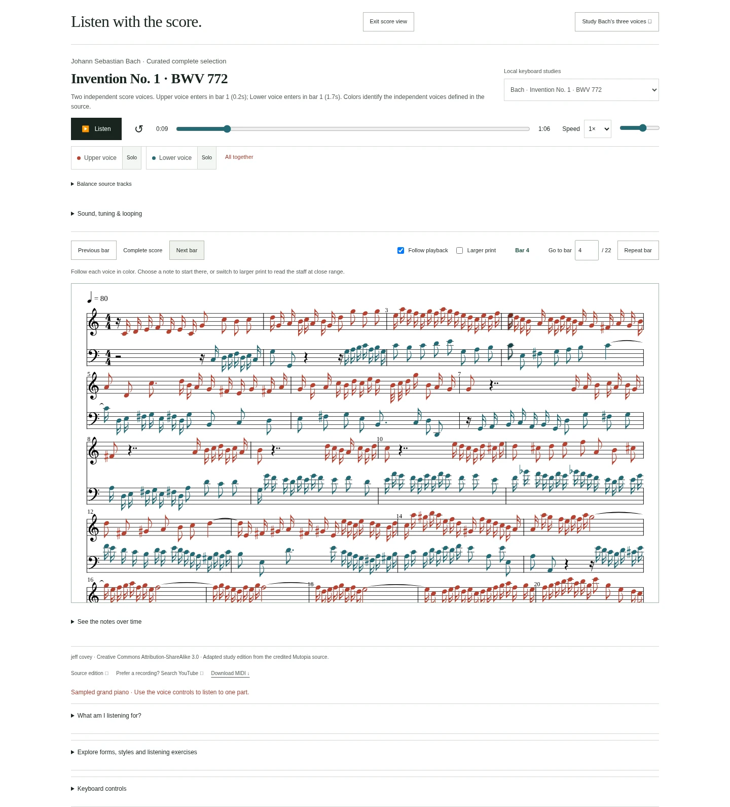

# Baroque · A listening atlas

Explore 102 composers on a historical European map, then listen to a complete
keyboard selection with its score. The curated desk has **50 pieces or named
movements: 30 Bach Inventions/Sinfonias and 20 selections across seven other
composers**. The catalog also keeps 510 linked works and 45 additional local
MIDI movements, including Bach's six Partitas.

## Run locally

Node.js 20 or later:

```sh
git clone --branch codex/sampled-piano-and-score-follow https://github.com/sargonxg/Baroque-music-room.git
cd Baroque-music-room
npm ci
npm test
npm run dev
```

Open http://127.0.0.1:8000. `npm run build` creates `dist/` for any static host.
No account, API key, database, model service or recording subscription is needed.
Builds use only local assets. Serve over HTTP for the separately loaded scores
and samples. External editions and recording searches need the internet.

## Try a listening study

Choose a composer on the map or in the directory. Filter by origin, musical
tradition or period. At the listening desk, choose a complete piece, press
Listen, and follow its coloured source-derived score. Click a note to seek;
mute or solo a line, slow a passage or set an A–B loop. Try harpsichord or piano.
The exact-title YouTube search link opens recorded performances separately.

The 50 curated selections use complete MusicXML study editions from pinned
Mutopia authored sources. OpenSheetMusicDisplay 2.3.0 engraves the score locally
and loads only at the listening desk. The free renderer is used with this
project's own local Web Audio transport, not its sponsored audio service.

Bach colours identify two or three **source-defined independent voices**.
Other selections distinguish source staves, which may contain multiple voices.
The additional 45 MIDI movements keep explicitly labelled MIDI-derived notation;
source tracks are not silently promoted to musical voices. The six-bar BWV 825
study remains available as a separate short example.

Source spelling, meter, rests, pickups and written-out repeats are retained in
the curated study scores. Layout and automatic beaming are modern. Editorial
marks are not all reproduced; grace notes remain visible but are unsounded,
and ornament signs are not realised by synthesis. This is a keyboard study,
not a concert recording or a historically authentic instrument simulation.

## Data and reproducibility

- `data/curated-fifty.json`: 50 pieces, edition links, sources, rights and hashes.
- `assets/curated/`: complete compressed MusicXML, study MIDI and timed note data.
- `data/curated-source-validation.json`: independent authored-source coverage checks.
- `data/composers.json` and `data/works.json`: the 102-composer/510-work atlas.
- `data/catalogue.json`: the 45 earlier source-MIDI movements.

The new assets contain 31,293 source score noteheads. Compact timing rows retain
stable note IDs, quarter offsets, measure boundaries and voice attribution;
only the selected piece is expanded in the browser. All 150 generated assets
rebuild byte-for-byte from the pinned authored sources. An ordinary build makes
no source downloads. See [data/curated-README.md](data/curated-README.md) for the
optional Python importer's reproduction commands and exact limitations.

The c. 1700 territory map is schematic. A dot identifies one working city, not
a modern nationality or birthplace. Shared-city composers remain accessible
through the directory; transitional figures, including Bach's sons, are labelled.

## Deploy a static copy

```sh
npm ci
npm run build
```

Upload only `dist/`. The included Workers Static Assets configuration disables
workers.dev and version previews until you configure your own route. Whole-host
Cloudflare Access is separate from the app's security headers. Nothing here
provisions a database, activates a paid service or establishes a spending cap.

## Rights and checks

Original runtime code is MIT; the historical map retains GPL-3.0. The optional
Python importer is GPL-3.0-or-later. Each converted music asset retains its
edition's PD, CC BY or CC BY-SA terms and named typesetter credit. The retained
OSMD licence travels with its pinned local bundle. See ATTRIBUTION.md.

`npm test` checks all 50 source/score/MIDI hashes, safe compressed-score entries,
source-note coverage, timing bounds, catalog filters, audio lifecycle, looping,
source notation and the emitted CSP. Browser captures and score alignment are
recorded separately; structural tests do not certify audible fidelity.

## Current browser view



[Phone score at larger print](docs/screenshots/practice-phone.webp).
These November 22, 2026 captures show the public personal-site integration.
The score, source colours, bar controls and transport use this repository’s
implementation. The host supplies its return link and shared reading shelf.
All 50 authored scores passed source-note alignment in the integrated CI run.
Desktop and phone flows passed against the published files. Phone checks use
browser emulation. Physical devices, screen readers and concert fidelity were
outside that verification.

The listening desk offers a sampled grand piano and synthesized period keyboards. Playback follows the authored score with a bar indicator and optional larger print. Shape short notes by adjusting their release. The attacks remain aligned with the notation. [Piano sources and license](assets/instruments/piano/provenance.json).

## Practice with a score

Choose **Focus on the score** to fold away the atlas. The transport stays at the
top of the practice view. **Previous bar**, **Next bar** and **Go to bar** use
the measure numbers in the source, including a pickup labelled 0. **Repeat bar**
loops the current measure. Turning the page or choosing another bar clears a
loop. Escape returns to the atlas controls.

The score gives each note a pitch, source part, bar and time in its accessible
label. Hover for the same information. The current bar has a light emphasis.
Use **Larger print** for closer reading or print the score from a focused view.

The piano now retains up to 6.25 seconds of recorded bass and middle-register
decay. Neighbouring sampled keys blend through the gaps. A lighter compressor
preserves differences in touch. **Gentle phrasing** adjusts release and eases
short notes before a rest. This is an adjustable listening interpretation.
The source attacks, measure times and downloaded MIDI remain the reference.

## Current practice view

These November 22, 2026 captures show the pinned app in the personal website.
The focused view, score, transport and bar controls use this repository’s
implementation. Chromium desktop and phone emulation passed, together with
all 50 source-score mappings and a simulated authenticated-media request.
Physical-device and perceptual audio checks are outside that verification.


[Phone notation at larger print](docs/screenshots/practice-phone.webp)

### Reading one line at a time

**Current line** keeps an entire engraved system together, including both
keyboard staves. Playback and bar navigation advance that line. **Full score**
restores all systems. Larger print remains available in either view. This uses
the same complete MusicXML and note-to-playback mappings as the full score.
Where the exported MusicXML omits beams, OSMD supplies rhythmic beam groups
without beaming across rests. These are a reading aid, not a claim about an
original manuscript’s editorial beaming. Source editions remain linked.

The sampled piano is unchanged in this update. No new audio service or paid
player is used. The page starts sound only after a visitor chooses playback.
