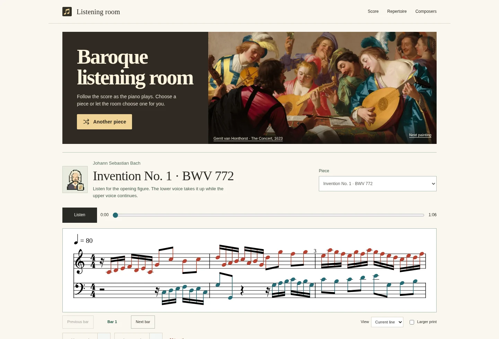

# Baroque listening room

Play a movement on a sampled stereo grand, follow the score and listen to each part on its own. The room has **402 distinct complete pieces or named movements by 14 composers**, including 233 by J. S. Bach. Choose **Another piece** to draw from the playable collection. A selection you opened manually counts as heard. The draw covers the whole shelf before starting a new round.

[Open the listening room](https://giulio-catanzariti.giuliocatanzariti.workers.dev/music) · [Try Bach’s two-part Invention in C](https://giulio-catanzariti.giuliocatanzariti.workers.dev/music?movement=bwv772#player) · [Hear the Goldberg Aria](https://giulio-catanzariti.giuliocatanzariti.workers.dev/music?movement=bwv988-aria#player)



[Phone view](screenshots/listening-room-phone.webp) · [Browse the repertoire](screenshots/listening-room-repertoire.webp)

## Listen and read

- Choose a selection or search a title, catalogue number, composer or collection. Bach shelves include all 15 Inventions and 15 Sinfonias, the Goldberg Aria and its 30 variations, the three Italian Concerto movements, keyboard partitas, suites, preludes and fugues. The room has the complete BWV 910 toccata and the final fugue from BWV 914. Six further complete keyboard toccatas and complete editions of keyboard Partitas Nos. 2, 3 and 6 have publisher-hosted scores and MIDI.
- Follow the moving score, select a note to seek, or use the arrow keys between notes. Mute and solo the coloured parts. Practice settings include speed, volume, passage looping and bar navigation. The focused view keeps the transport by the score.
- The 63 MusicXML studies preserve the source notation. OpenSheetMusicDisplay 2.3.0 engraves a full score or a single system on demand. The 30 Bach Inventions and Sinfonias have source-defined independent voices. Other scores identify their source staves or parts.
- The other 339 pieces or movements have synchronized reading notation derived from source MIDI. Note timing and pitches come from the edition. Clefs, rests, enharmonic spelling and rhythm symbols are inferred. Consecutive short notes share a beam within the beat, and reading pages turn on the source downbeat. Colours and numbered labels follow the source tracks, which may combine musical voices. Open the published score for the original engraving.
- Each selection has recording search and edition links. Scoring is identified in the edition information for the additional orchestral, vocal, organ and chamber repertoire. All local playback uses piano. Two alternate MIDI editions of Scarlatti K. 11 and Handel’s Aylesford overture retain their original bookmarks. The separate six-bar BWV 825 exercise has three source-defined voices and sits outside the 402 total.

## Explore the atlas

Select a working city on the c. 1700 map or search for one of its **104 composers**. Where composers share a city, the profile includes a local list. Arrow keys move between map markers. The directory filters by origin, musical tradition and period. Bach’s sons and other transitional figures carry period labels.

Each composer has five starting points with links to an edition and recordings. A separate, searchable Open Opus archive holds 5,017 bibliographic records. External selections can be opened on their source sites.

The rotating cover features *The Concert* by Gerrit van Honthorst, *The Lute Player* by Orazio Gentileschi and *The Music Lesson* from the studio of Gerard ter Borch the Younger. Each image links to its National Gallery of Art record. [Museum credits and image rights](assets/gallery/works.json)

## Run locally

Run these commands with Node.js 20 or later.

```sh
git clone --branch codex/sampled-piano-and-score-follow https://github.com/sargonxg/Baroque-music-room.git
cd Baroque-music-room
npm ci
npm test
npm run dev
```

Open http://127.0.0.1:8000. Use a local HTTP server so the browser can load the selected scores, samples and edition packs. The ordinary build uses the committed source data. External score and recording links open the publisher or search service.

## Editions and piano

| Source | Contents |
| --- | --- |
| [Core studies](data/curated-fifty.json), [Mutopia supplement](data/curated-supplement.json) and [BWV 914 final fugue](data/musicxml-additions.json) | 63 MusicXML studies, MIDI, stable note IDs and timed note data. Source snapshots and attribution link each study to its edition. [Rebuild the authored scores](data/curated-README.md) |
| [Source-MIDI catalogue](data/catalogue.json) | 45 previously published complete movements, plus a separate six-bar exercise and a [rights register](data/rights.json). |
| [Additional editions](data/edition-library.json) | 296 complete selections in 18 compressed family packs. A browser fetches a pack when a selection needs it. The original MIDI download preserves the publisher's exact bytes. [Import, verify and rebuild the 18 packs](scripts/editions/README.md) |
| [Composers](data/composers.json) and [works](data/works.json) | 102 profiles and 510 suggested works, plus two profiles from the additional editions. The browser derives five playable recommendations apiece for Royer and Titelouze. |
| [Open Opus archive](data/archive/manifest.json) | Reproducible public-domain work catalogue. Rebuild from a saved Open Opus dump with `node scripts/import-work-archive.mjs /path/to/work-dump.json`. |

The extra editions include 311,678 source note events and just under twelve hours at their published MIDI tempi. They include Vivaldi’s twelve *Four Seasons* movements, the nine German arias by Handel, Royer’s fourteen *Pièces de clavecin* and twenty-three organ versets by Titelouze.

The grand uses 30 sampled roots from A0 to C8, each with a soft and a medium strike. Web Audio blends between velocities, preserves the stereo microphone image, damps repeated notes and resumes sustained notes at the correct point after a seek. Samples load on play. Rebuild from the pinned Salamander Grand Piano recordings with FFmpeg and `python scripts/import-piano-samples.py /path/to/flac --fetch`. [Sample attribution and file hashes](assets/instruments/piano/provenance.json)

The engraved studies retain pickups, rests and source spelling. Automatic beaming is modern. Grace notes are visible and silent. Ornament signs are reproduced where supported, without synthesized elaboration. Piano renderings of vocal and orchestral music preserve the selected edition's pitches and timing.

## Static deployment and checks

```sh
npm ci
npm run build
```

Publish `dist/` on a static web server. The included Workers Static Assets configuration disables workers.dev and version previews until the operator configures a route. Cloudflare Access, custom domains and account billing remain host settings. The application uses static assets, local search and Web Audio.

`npm test` verifies score/edition integrity and timing, source-note coverage, MIDI downloads, repertoire search and shuffle, notation pagination, piano behavior and emitted Content Security Policy. The room’s runtime is MIT licensed. Each score, sound and visual asset carries its own source licence. [Full attribution](ATTRIBUTION.md)

The November 25 browser check selected all 404 playable editions, including both alternatives, through the production UI and sought to the middle of each. It exercised play, pause, shuffle during playback, keyboard notes and cities, a byte-verified MIDI download, and phone-sized layouts. The phone checks ran in Chromium emulation. [Browser receipt and screenshot hashes](screenshots/listening-room-checks.json)
